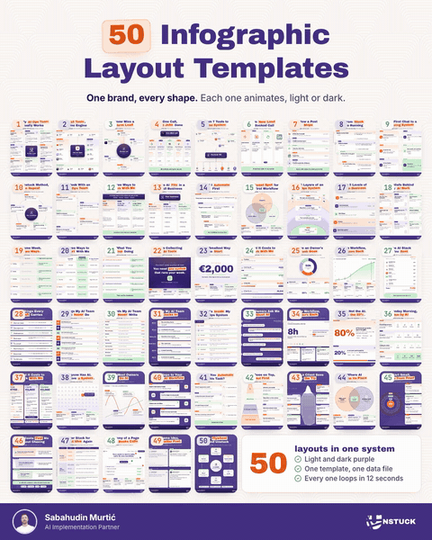

# 50 Infographic Layout Templates

50 infographic layouts for LinkedIn and Instagram, built in code. Every one exports as a still (1080 x 1350 PNG) and a 12 second animated loop (MP4 and GIF), in light or dark. One template, one theme and one small text file per post, so every post looks like it came from the same brand.

> **Get more free AI templates, skills and systems in the free Unstuck Community:**
> **[Join the Unstuck Community (free)](https://whop.com/unstuck-your-business/unstuck-community/)**

Made by [Sabahudin Murtić](https://www.linkedin.com/in/sabahudin-murtic), AI Implementation Partner. The full preview video is in [`preview/showcase-tour.mp4`](preview/showcase-tour.mp4).

## Make it yours in one step

1. Clone this repo and open the folder in [Claude Code](https://claude.com/claude-code).
2. Type `/setup-brand` (or paste [`SETUP-PROMPT.md`](SETUP-PROMPT.md) into the chat).
3. Answer its questions. It sets up your colours, fonts, logo, photo, name and title, then renders a first infographic so you can check it.

You can start from scratch with **your own brand**, or **keep this look** and only swap in your colours, photo, fonts and logo.

## What you need

- Google Chrome (renders the stills; set `CHROME=/path/to/chrome` if it is not in the macOS default place)
- Node.js 18 or newer (animations run through [HyperFrames](https://github.com/heygen-com/hyperframes), fetched by `npx`)
- ffmpeg (turns the animation into a GIF)
- Python 3 with Pillow (`pip install pillow`), only for the showcase scripts

## Make an infographic

Run everything from the repo root.

1. Copy the closest file in `data/` and change the words. `layout` picks the shape. Wrap one or two key title words in `<g>...</g>` for the sticker highlight.
2. Still: `scripts/render.sh data/<file>.json` writes `out/<file>.png`.
3. Animation: `scripts/make-motion.sh data/<file>.json` writes the still, a 12 second loop as `out/<file>.mp4` and `out/<file>.gif`.
4. Dark version: add `"theme": "purple-dark"` to the data file, or run `THEME=purple-dark scripts/render.sh data/<file>.json`.

Your name, title and photo come from `me.json`, so you set them once. Every example still is in `examples/`.

**Tool logos.** Cards can show a real tool logo (`"logo": "slack"`). Logos are not shipped in this repo. Get a free key at [logo.dev](https://www.logo.dev), put `LOGO_DEV_TOKEN=...` and `LOGO_DEV_SECRET_KEY=...` in a `.env` file here, then run `scripts/fetch-logo.sh slack.com`. Without the logo the card shows the tool's name.

## Which layout for which idea

| Layout | Use it when the idea is | Example |
|---|---|---|
| `hub` | one system with up to 8 parts around it | `ai-ops-loop` |
| `radial-hub` | a whole tool stack, grouped by job, around one engine | `one-engine` |
| `radar` | something always watching many sources | `never-miss-a-lead` |
| `fan-out` | one input turns into many outputs | `one-call-five-jobs` |
| `untangle` | many tools become one system | `seven-tools-one-system` |
| `pipeline` | 4 tool steps left to right, each marked AI or Me | `lead-to-call` |
| `vertical-steps` | a tool chain top to bottom, one tool per step | `how-a-post-ships` |
| `stairs` | 3 to 5 stages that build on each other | `stuck-to-running` |
| `serpentine` | a longer journey that snakes down the page | `dm-to-system` |
| `loop` | a method that repeats | `unstuck-method-loop` |
| `spine` | a week or a timeline, cards off a centre line | `ai-ops-week` |
| `column-flow` | one starting point feeding a few parallel paths | `work-with-me` |
| `tree` | one root that breaks into 3 branches | `where-ai-fits` |
| `funnel` | many narrowed down to one | `what-to-automate` |
| `venn` | where three things overlap | `first-workflow-sweet-spot` |
| `layers` | layers from the outside to the core | `ai-ops-layers` |
| `ladder` | levels, from basic to advanced | `ai-levels` |
| `grid` | a set of up to 9 equal items | `nine-beliefs` |
| `compare` | the old way against the new way, row by row | `two-ways` |
| `matrix` | 2 or 3 options across several attributes, one recommended | `three-ways-to-start` |
| `vanish-list` | what you stop doing | `what-you-stop-doing` |
| `billboard` | one bold claim, with 3 supporting cards | `stop-collecting-tools` |
| `big-number` | one hero number | `big-number-pilot` |
| `bars` | a few values compared on one scale | `bars-what-it-costs` |
| `donut` | how a whole splits into parts | `donut-owner-week` (example data) |
| `growth-curve` | a change over time | `growth-one-workflow` (example data) |
| `receipt` | a cost teardown | `ai-stack-receipt` (example data) |
| `checklist` | a checklist where every item is ticked | `proposal-checklist` (dark) |
| `number-list` | a numbered list with big numbers | `never-do` |
| `dense-list` | many short items, one line each | `words-never-written` |
| `schedule` | a day by the clock | `ai-team-day` (dark) |
| `folder-tree` | how something is organised, as folders | `inside-the-system` |
| `dialogue` | questions and answers as a chat | `what-owners-ask` (dark) |
| `case-study` | one result, before and after | `case-study-follow-ups` (dark, example data) |
| `split-stat` | the few that matter against the rest | `the-20-percent` (example data) |
| `routine-board` | a routine in stages, with tools and facts | `monday-routine` |
| `pricing` | offers side by side, one recommended | `pricing-work-with-me` (dark) |
| `standout` | one that stands out from the crowd | `stand-out-with-ai` |
| `wave` | ups and downs against one steady line | `the-ai-rollercoaster` (dark) |
| `zigzag` | steps that alternate down the page | `first-workflow-steps` (dark) |
| `decision-tree` | yes or no questions that lead to one answer | `should-you-automate` |
| `pyramid` | a foundation that everything sits on | `ai-on-top` |
| `iceberg` | what shows against what sits underneath | `client-sees-the-tip` (dark) |
| `venn2` | where two things overlap | `where-ai-earns-its-place` |
| `rings` | growing outward from a core | `grow-from-proof` (dark) |
| `funnel-notes` | a funnel with a note at each stage | `how-clients-find-me` (dark) |
| `content-matrix` | pillars by angles, as a grid of ideas | `content-pillars` |
| `page-anatomy` | a page or screen with numbered call-outs | `page-that-books-calls` |
| `post-compare` | a weak version against a better one | `better-first-lines` (dark) |
| `wheel` | a flywheel where each part feeds the next | `unstuck-flywheel` (dark) |

## The showcase

`data/showcase-50.json` is the grid of all 50. `scripts/make-showcase-tour.sh data/showcase-50-tour.json` makes the tour in the preview: the layouts listed under `tour` pop up one by one and play their real animation (render each of them with `make-motion.sh` first). After adding or changing a layout, run `python3 scripts/make-showcase-thumbs.py` to refresh the thumbnails.

## What is where

| Path | What it holds |
|---|---|
| `me.json` | your name, title, initials and photo for the byline |
| `themes/brand-colours.css` | the palette every theme picks from |
| `themes/b-warm.css`, `themes/purple-dark.css` | the light theme (default) and the dark theme |
| `tokens.css` | type, shape, sticker colours, pattern opacity |
| `fonts.css`, `fonts/` | the fonts (Archivo Black, Inter, JetBrains Mono, all OFL) |
| `components/base.css` | page, title sticker, cards, tags, chips, icon tiles, footer bar |
| `layouts/` | the 50 layouts; `layouts/CONTRACT.md` says how to add one |
| `templates/infographic.html` | the one template every layout runs in |
| `assets/logo/` | your logo (four files: mark and horizontal lockup, each for light and dark) |
| `assets/avatar.jpg` | your photo |
| `data/` | one file per infographic |
| `scripts/` | render a still, render the animation, the showcase, icons, pattern, logos |

## Licence

Free to use for your own content and your clients' content, including commercial posts. You may not sell or redistribute the templates themselves. See [LICENSE](LICENSE). Fonts, icons and libraries keep their own licences, listed in [NOTICE.md](NOTICE.md).
